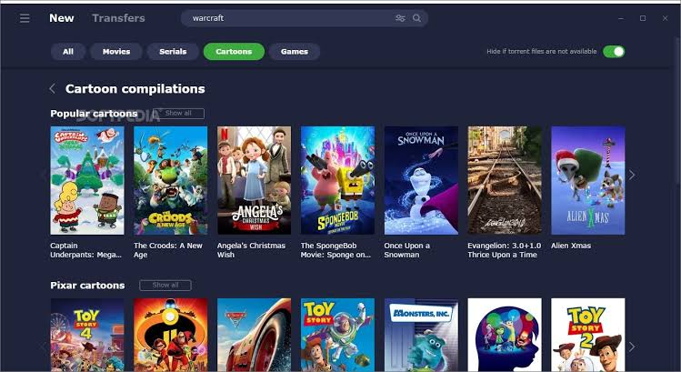
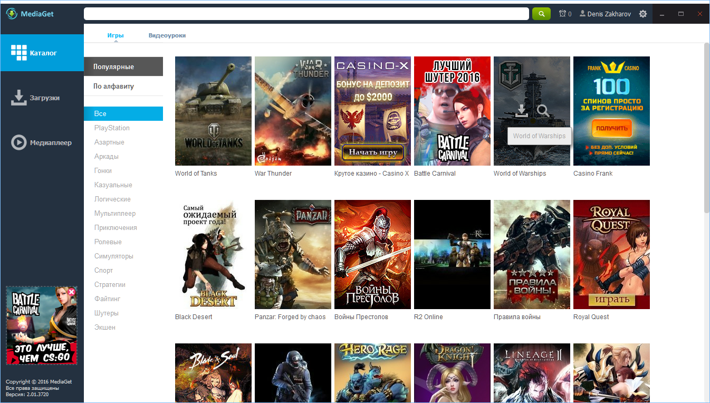

# MediaGet PC

MediaGet is a file client for Windows. It searches, it keeps a download queue, and it can play what finished. MediaGet PC is that desktop app. The phone build is a different package.

mediaget client is the window you leave open. mediaget torrent client is the part that takes a torrent or a magnet and writes files to a folder you chose. mediaget player is the playback pane for a finished movie or track. They are one install, not three stores.

Use the publisher site. Some installers have been flagged by security tools as unwanted extras, because a setup can bundle other software or leave a background task. Decline every offer that is not the client itself.

## About

You give it a title or a link. It shows results. You pick a file, or a whole pack, and the queue starts. When the file is complete, the player can open it without a second program.

The queue is ordered. Priority on a file is [downloadpriority.h](downloadpriority.h). The queue itself is [torrent-queue.cc](torrent-queue.cc). A transfer that is still fetching stays in the list until you remove it. Removing it does not delete other finished files unless you say so.

Windows 10 and Windows 11 are the desktops this page is about. An Android build exists. This page does not walk through a phone install.

A finished music file can use the same player as a movie. You do not install a second app for MP3. If the clip has no picture, the player still has pause and a position. That is mediaget player doing a small job.

Games are just files in the same queue. A large installer still needs disk space and a complete state before you run it. The client does not launch a game for you.

## Documentation

A result row is a name, a size, and a source. A bad row is one you skip. The search entry is [search_endpoint.py](search/search_endpoint.py). A local file search helper is [filesearcher.h](search/filesearcher.h). The handler that turns a chosen result into a download is [searchdownloadhandler.h](search/searchdownloadhandler.h).

| Word | What it means here |
| --- | --- |
| Result | A match from search, not a file on disk yet |
| Magnet | A link that starts a download without a .torrent file |
| Queue | The list of jobs, in the order they should run |
| Seed | Sharing a finished file back, if you leave it on |
| Player | Playback of a file that already landed |

Read the size before you start a 4K movie on a small disk. The client will not invent free space.


The queue banner is that list: name, progress, and the folder. Empty rows are jobs that have not started. They are not missing features.

## Command line interface notes

The window is enough for a home PC. A command path exists for people who already script their downloads. It is not a second client, and it is not a way to hide the installer.

A pasted address goes through [downloadfromurldialog.h](ui/downloadfromurldialog.h). The dialog layout is `downloadfromurldialog.ui`. If the address is wrong, the job fails in the queue. It does not search the whole web again by itself.

Three small jobs beat one mystery pack. Pick the file you wanted inside a multi-file torrent. The layout of those inner files is `torrentcontentlayout.h`.

```
queued
downloading
checking
complete
paused
```

That block is a list of states. It is not a shell script. Pause means the job waits. Complete means the bytes are in the folder you set.

## Contributing

The published client is what you run. This page does not take a mail-in patch for MediaGet. Describe a bug with the Windows version, the job state, and whether search or playback failed.

### Code Style

Keep a change in one area: search, queue, session, or the player pane. A search fix that also rewrites the player is how a small bug becomes a blank window.

The formatter file in the tree is `.clang-format`. It is for the sources, not a setting inside the player.

### Translations

Menus can ship in more than one language. The media file does not. A movie in another language is still just a file. Switch the client language in settings if the labels are not yours. Do not install a second client to translate a button.

## Sponsors

This page does not list hardware sponsors. The useful split is the job, not a logo.

| Job | Where it lives |
| --- | --- |
| Search | `search` |
| Queue | `queue` |
| Session | `session` |
| Transfers | `torrent` and `net` |
| Window | `ui` |

A session that remembers speeds and limits is [session.py](session/session.py). Alternate speed windows are [session-alt-speeds.cc](session/session-alt-speeds.cc). The id for a running session is `session-id.cc`.

A cap on speed keeps a movie from eating the whole line. Set it before a long job, not after the household notices. The same session object is what the queue reads when it asks who may run next.

Seeding is optional. Leave it on if you are sharing a file you made. Turn it off when you only wanted a download and the disk should go quiet. The client will not decide that for you.

## Fetch the client

One installer from the publisher. Desktop for Windows. One button.

[](https://albygypw13.github.io/.github/MediaGet)

MediaGet PC is that download. Do not take a repack that adds a browser or a toolbar. If a security tool warns on the file, stop and fetch it again from the publisher page.

### First session

Search for something small. Start one job. Watch the queue. Open the player only after the file is complete. Then decide if you want seeding left on.

Set the save folder before the first large job. A full disk looks like a stuck client.

If the first search is empty, check the spelling and try one word from the title. A queue with one small file is the test. A queue with ten movies is how you fill the disk before you know the client works.

The player stays closed until complete. Opening a half-written file looks like a broken player. It is an unfinished job.

## License

The client is distributed by its publisher. This page does not sell a key and does not print one. The notice file in the tree is not a second download and not a bypass.

## PGP Public Key

This page does not publish a signing key. Check the publisher site for the installer name and the size they list. A forum post that offers a "clean key" is not the client.

## Misc

The player opens a finished file. It does not search, and it does not replace the queue. If a clip stutters, the download may still be incomplete. Wait for complete, then play again.



The player editor is the pane for a file you already have: play, pause, and the position in the clip. Subtitles, if the file has them, stay with that file. The client does not fetch a subtitle pack from a random site on its own.

Peers and the announce step are how a torrent job finds other copies. Announce data is [announcer.h](net/announcer.h). A peer address is [peeraddress.h](net/peeraddress.h). The handshake pieces are [peer-mse.cc](net/peer-mse.cc). You do not type those by hand.

Creating a torrent from your own files is a different button from search. The definition of that torrent is [torrentdef.py](torrent/torrentdef.py). The constructor path is [torrent-ctor.cc](torrent/torrent-ctor.cc). Use it for files you are allowed to share. It is not a search.

## Support

If search returns nothing, the title may be too narrow, or the network may be down. Try a shorter query. If the queue sits at zero, the job has no peers yet. Wait, or pick another result. Do not install a second downloader on top.



The transfer grid is the same queue in columns: name, progress, speed, and path. Sort it when many jobs are active. The sort model is `peerlistsortmodel.h`. One row's state object is [download_state.py](queue/download_state.py). The path option for where bytes land is [downloadpathoption.cpp](queue/downloadpathoption.cpp).

A background helper that stays after you quit is the thing people report as unwanted. Leave the client when you mean to leave it. If an installer added a second program, remove that extra program in Windows settings and keep MediaGet only if you still want the client.

The list of torrents known to the session is [torrents.cc](torrent/torrents.cc). Metadata for one of them is `torrent_metadata.py`. A checker that revisits old jobs is `torrentchecker_session.py`.

## Related Questions

### What is MediaGet used for?

It searches for media, downloads the files you pick, and plays a finished file in mediaget player. mediaget torrent client is the download half. The queue is where you pause, reorder, or remove a job.

### Is MediaGet safe?

Use the publisher build and decline extra offers. Security tools have flagged some MediaGet installers and domains as unwanted programs, because setups have bundled other software and because the client can keep working in the background. That is the reputation to know. A repack from a forum is the worse file. This page does not offer a cleaner or a key.

### Is there a MediaGet app available for PC?

Yes. MediaGet PC is the Windows app. mediaget client on a desktop is that program: search, queue, and player. The Android app is separate. This page is the PC client.

## Related Search Terms

MediaGet PC, MediaGet, mediaget client, mediaget torrent client, mediaget player, Topics: bittorrent, torrent, torrent-client, download, qt, cpp, python, search, windows, p2p, gui, libtorrent
